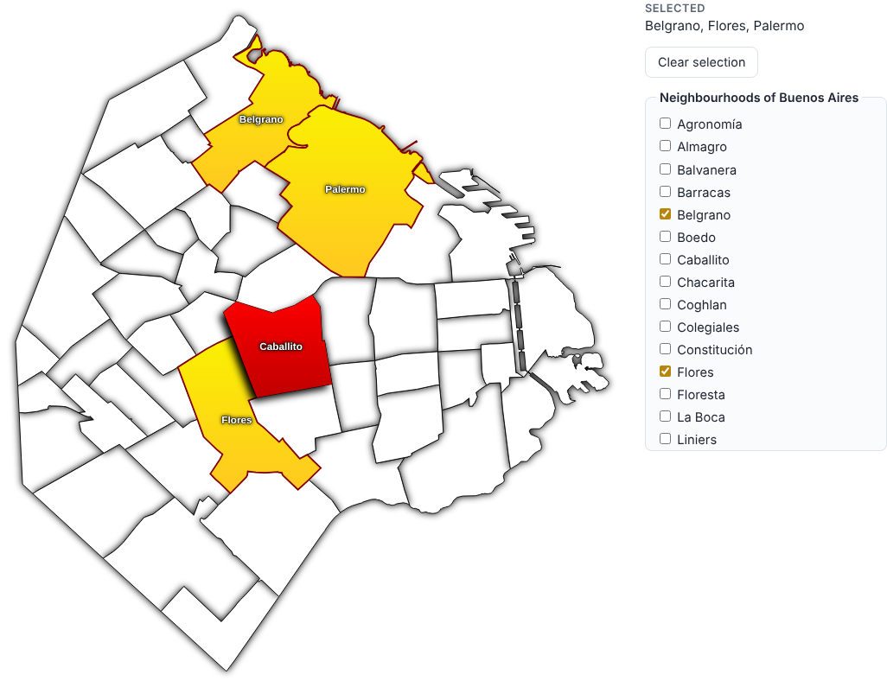

# area-map

Turn any GeoJSON file into a **selectable SVG map**: neighbourhoods, districts,
provinces, countries, anything that can be described with polygons.

- **One script** (`tools/geojson-to-svg.mjs`, Node.js, no dependencies) builds
  a self-contained `.svg` with the shapes, the selection logic and keyboard and
  screen-reader support.
- **One stylesheet** (`src/area-map.css`) styles every generated map. Restyle
  your maps without touching the SVG files.
- **Checkboxes stay in sync for free**: add `data-area-map="<map id>"` to a
  checkbox and clicking the map checks it, and checking it selects the area.

**Live demo:** https://carlos-illobre.github.io/area-picker/



---

## Contents

1. [Quick start](#1-quick-start)
2. [Preparing your data](#2-preparing-your-data)
3. [Script reference](#3-script-reference)
4. [Adding the map to your project](#4-adding-the-map-to-your-project)
5. [Syncing with checkboxes](#5-syncing-with-checkboxes)
6. [JavaScript API](#6-javascript-api)
7. [Styling](#7-styling)
8. [Compatibility and limitations](#8-compatibility-and-limitations)
9. [Development](#9-development)

---

## 1. Quick start

You need [Node.js](https://nodejs.org/) 18 or newer. Nothing else to install.

```bash
git clone https://github.com/carlos-illobre/area-picker.git
```

```bash
cd area-picker
```

Generate a map from one of the bundled examples:

```bash
node tools/geojson-to-svg.mjs examples/data/caba-barrios.geojson -o barrios.svg --map-id barrios --name-prop nombre --title "Buenos Aires" --inputs barrios-checkboxes.html
```

That writes two files:

- `barrios.svg`: the map;
- `barrios-checkboxes.html`: a ready-made list of checkboxes, one per area,
  already bound to the map.

Copy `src/area-map.css` next to `barrios.svg` and open the SVG in a browser:
hover and click the areas. Then put it in a page (see
[section 4](#4-adding-the-map-to-your-project)).

---

## 2. Preparing your data

The input is standard [GeoJSON (RFC 7946)](https://datatracker.ietf.org/doc/html/rfc7946):
`[longitude, latitude]` coordinates in WGS 84. Open data portals, Natural
Earth, OpenStreetMap exports, QGIS ("Export → GeoJSON") and `ogr2ogr` all
produce it.

- Every **Feature** becomes one selectable **area**.
- `Polygon` and `MultiPolygon` geometries are used (islands and holes
  included); points and lines are ignored.
- The area name comes from a property. `name`, `nombre`, `NAME`, `NAME_EN`,
  `ADMIN`... are detected automatically; use `--name-prop` for anything else.
- The area **id** is the slug of its name (`Villa Crespo` → `villa-crespo`),
  or of the property given with `--id-prop` (e.g. an ISO code). Ids are what
  your code and your checkboxes use.

```json
{
  "type": "FeatureCollection",
  "features": [
    {
      "type": "Feature",
      "properties": { "name": "Palermo" },
      "geometry": { "type": "Polygon", "coordinates": [[[-58.43, -34.57], [-58.40, -34.58], [-58.41, -34.60], [-58.43, -34.57]]] }
    }
  ]
}
```

Shapefile or another format? Convert it first, for example with GDAL:

```bash
ogr2ogr -f GeoJSON -t_srs EPSG:4326 areas.geojson areas.shp
```

---

## 3. Script reference

```bash
node tools/geojson-to-svg.mjs <input.geojson> [-o output.svg] [options]
```

Run `node tools/geojson-to-svg.mjs --help` for the same list.

| Option | Description |
|---|---|
| `-o, --output <file>` | Output SVG. Default: standard output. |
| `--inputs <file>` | Also write an HTML fragment with one checkbox per area (radio buttons with `--single`), sorted by name and bound to the map. |
| `--map-id <id>` | Map id. Binds external checkboxes and prefixes internal ids so several maps can share a page. Default: the output file name. |
| `--name-prop <prop>` | Property with the display name. Default: auto-detected. |
| `--id-prop <prop>` | Property used for the area ids (slugified). Default: the slug of the name. |
| `--label-prop <prop>` | Property with the label position, `[lon, lat]` or `{lon, lat}`. Default: computed inside the largest polygon. |
| `--title <text>` | Accessible title of the map. |
| `--desc <text>` | Description, e.g. the data attribution. |
| `--width <px>` | SVG width (default `800`). The height follows the shape of the data. |
| `--padding <px>` | Inner margin, room for the shadows (default `20`). |
| `--projection <name>` | `mercator` (default), `equirectangular`, or `identity` for data that is already projected. |
| `--simplify <px>` | Simplification tolerance in pixels (default `0.25`, `0` turns it off). Shared borders are simplified identically, so neighbours never get gaps between them. |
| `--precision <n>` | Decimals in the coordinates (default `1`). |
| `--min-island <px²>` | Drop islands smaller than this many square pixels (never an area's main polygon). |
| `--bbox <w,s,e,n>` | Drop polygons whose center falls outside this box, in degrees. Useful for far-away territories. |
| `--merge <from=to>` | Merge one area into another. Repeatable. |
| `--rename <id=Name>` | Change an area's display name; its id stays the same. Repeatable. |
| `--single` | Single selection: selecting an area deselects the previous one. |
| `--css <href>` | Stylesheet path as seen from the SVG (default `area-map.css`). |
| `--no-css` | Do not link any stylesheet. |
| `--no-script` | Do not embed the JavaScript (load `src/area-map.js` yourself). |

### Examples

Countries, using ISO codes as ids, single selection:

```bash
node tools/geojson-to-svg.mjs countries.geojson -o countries.svg --id-prop ISO_A3 --single
```

The South America map from the demo. Natural Earth lists the Malvinas Islands
separately, so they are merged into Argentina; `--bbox` drops mainland France
and keeps French Guiana:

```bash
node tools/geojson-to-svg.mjs examples/data/sudamerica-paises.geojson -o paises.svg --width 600 --bbox -82,-56,-34,13 --min-island 4 --merge falkland-is=argentina --rename brazil=Brasil --single
```

### From Node.js

```js
import { geojsonToSvg, geojsonToInputs } from "./tools/geojson-to-svg.mjs";

const svg = geojsonToSvg(geojson, { mapId: "barrios", nameProp: "nombre", width: 600 });
const checkboxes = geojsonToInputs(geojson, { mapId: "barrios", nameProp: "nombre" });
```

Options use the same names as the command line, in camelCase (`minIsland`,
`idProp`...). `merge` and `rename` take objects: `{ "falkland-is": "argentina" }`.

---

## 4. Adding the map to your project

Pick the option that fits your project:

| How | Stylesheet | Interactive | Best for |
|---|---|---|---|
| **A. Inline `<svg>`** in your HTML | `<link>` in your page | Yes | Most projects. Same DOM as your page, easy to style and script. |
| **B. `<object>`** or `<iframe>` | linked by the SVG itself | Yes | Keeping the map as a separate file. |
| **C. ``** or CSS background | not loaded | No | A static picture only. |

### A. Inline SVG (recommended)

1. Copy `src/area-map.css` into your project and link it:

   ```html
   <link rel="stylesheet" href="area-map.css">
   ```

2. Paste the content of the generated `.svg` where the map should go,
   **without** its first lines (`<?xml version...?>` and
   `<?xml-stylesheet...?>`):

   ```html
   <svg class="area-map" data-am-map="barrios" ...>
     ...
   </svg>
   ```

   With a server-side template engine, include the file and strip those lines.

That's it: the map is interactive, because the selection script travels inside
the SVG. It shrinks to fit narrow screens on its own (`max-width: 100%`).

**Inserting the SVG with JavaScript or a framework** (`innerHTML`, React's
`dangerouslySetInnerHTML`, Vue's `v-html`...): browsers do not run scripts
inserted that way, so load the runtime once in your page and initialize the
map after inserting it:

```html
<script src="area-map.js"></script>
```

```js
container.innerHTML = svgText;
AreaMap.init(container.querySelector("svg.area-map"));
```

### B. `<object>` or `<iframe>`

Put the `.svg` and `area-map.css` side by side (or generate with
`--css path/to/area-map.css`), then:

```html
<object type="image/svg+xml" data="barrios.svg"></object>
```

The map runs in its own document. To sync checkboxes with it, also load
`src/area-map.js` in your page (see [section 5](#5-syncing-with-checkboxes)).
To talk to it from your own code, use `postMessage` (see
[section 6](#6-javascript-api)).

Some browsers restrict pages opened from disk (`file://`), so serve the files
over HTTP while testing option B (`python3 -m http.server`, `npx serve`...).

### C. ``

```html

```

Browsers load no external stylesheets and run no scripts inside ``: you
get a plain black-and-white map.

---

## 5. Syncing with checkboxes

Any checkbox whose `data-area-map` is the map id and whose `value` is an area
id is kept in sync with the map, both ways:

```html
<label><input type="checkbox" data-area-map="barrios" value="palermo"> Palermo</label>
<label><input type="checkbox" data-area-map="barrios" value="recoleta"> Recoleta</label>
```

- Clicking an area on the map checks or unchecks its checkbox.
- Checking a checkbox selects the area on the map.
- Boxes that are already checked when the page loads (server-rendered values,
  or a form restored by the browser) select their areas.
- For single-selection maps (`--single`) use radio buttons with a shared
  `name`.
- Because they are regular inputs, add a `name` and they are submitted with
  your `<form>`, with no extra code.

You don't have to write the list by hand: `--inputs <file>` generates it,
sorted by name:

```bash
node tools/geojson-to-svg.mjs areas.geojson -o areas.svg --map-id areas --inputs areas-checkboxes.html
```

```html
<fieldset class="area-map-inputs" data-area-map-inputs="areas">
  <legend>areas</legend>
  <label><input type="checkbox" name="areas" value="agronomia" data-area-map="areas"> Agronomía</label>
  ...
</fieldset>
```

Where it works:

- **Inline maps**: works with no extra script, because the runtime embedded in
  the SVG handles the binding.
- **`<object>` / `<iframe>` maps**: add `<script src="area-map.js"></script>`
  to your page, which carries the messages between the map and the checkboxes.

---

## 6. JavaScript API

Each inline map exposes an `areaMap` object:

```js
const map = document.querySelector('svg[data-am-map="barrios"]');

map.areaMap.select("palermo");         // select
map.areaMap.select("palermo", false);  // deselect
map.areaMap.toggle("palermo");
map.areaMap.clear();
map.areaMap.selected();                // ["palermo", ...]
map.areaMap.areas();                   // [{ id: "palermo", name: "Palermo" }, ...]
```

The map fires an `areachange` event when the selection changes through a click
or a key on the map, or through `select` / `toggle` / `clear`:

```js
map.addEventListener("areachange", (e) => {
  const { map, id, name, selected, selection } = e.detail;
});
```

Changes made by bound checkboxes do not fire `areachange`; listen to the
checkboxes' own `change` event if you need them.

### Maps inside `<object>` / `<iframe>`

The map posts a message to your page on every change:

```js
window.addEventListener("message", (e) => {
  if (e.data && e.data.type === "area-map:change") {
    // e.data = { type, map, id, name, selected, selection }
  }
});
```

Send one to replace its selection:

```js
objectElement.contentWindow.postMessage({ type: "area-map:select", map: "barrios", ids: ["palermo"] }, "*");
```

On the same origin you can also call the API directly:
`objectElement.contentDocument.documentElement.areaMap.select("palermo")`.

---

## 7. Styling

`src/area-map.css` reproduces the look of the original canvas version:

| State | Look |
|---|---|
| Normal | White fill, black 1px border, soft black shadow |
| Hover / keyboard focus | Red gradient (`#ff0000` → `#bf0000`), shadow offset down-left, name shown |
| Selected | Yellow gradient (`#faf100` → `#ffc821`), maroon 2px border, name shown |
| Names | Bold 13px sans-serif, white with a black outline and shadow |

Fades between states take 120 ms and are turned off for users who ask for
reduced motion.

**Change the look without editing the SVG files**, in your own stylesheet
loaded after `area-map.css`:

```css
/* every map */
.area-map {
  --am-selected-start: #9be15d;
  --am-selected-end: #00b09b;
  --am-selected-stroke: #006d5b;
  --am-hover-start: #4f8cff;
  --am-hover-end: #1f5fd6;
  --am-font-family: Georgia, serif;
  --am-transition: 0s;
}

/* one map only */
svg[data-am-map="barrios"] .am-area { filter: none; }   /* no shadows */
```

Every variable is listed and explained at the top of `src/area-map.css`.
Gradients and shadows are defined inside the SVG, because SVG `<filter>` and
`<linearGradient>` work in more browsers than CSS `drop-shadow()`. Their colors
still come from the CSS, and CSS can replace them (`fill: #ccc`) or remove them
(`filter: none`).

To write your own rules, target this structure:

```
svg.area-map[data-am-map="…"][data-am-mode="single"]?
├── g.am-areas      > use.am-area[data-area]                       every area
├── g.am-selection  > use.am-selected[data-area][data-selected]    selected look
├── g.am-labels     > text.am-label[data-area][data-selected]      names of selected areas
└── g.am-hits       > g.am-hit[data-area][aria-checked]            pointer and keyboard layer
                      ├── use.am-hover                             hover look
                      ├── text.am-hit-label                        name on hover
                      └── use.am-target                            transparent click target
```

---

## 8. Compatibility and limitations

The generated SVG avoids newer features so it works in as many browsers and
viewers as possible:

- SVG 1.1 markup with `xlink:href`;
- SVG filters instead of CSS `drop-shadow()`;
- presentation attributes as a fallback, so the map is readable even with no
  stylesheet;
- a plain value before every CSS `var()`;
- ES5 JavaScript;
- keyboard support and ARIA roles (`role="checkbox"`, `aria-checked`).

Known limitations:

- Polygons crossing the antimeridian (±180°, e.g. Russia or Fiji) are not
  split. Clip them beforehand or drop them with `--bbox`.
- Labels are sized for the SVG's own width. Shown much smaller (e.g. on a
  phone), they shrink with the map.
- To keep labels inside the map, their width is estimated. A much larger font
  set in your CSS may clip a name sitting right at the edge.
- Several inline maps on one page share the ids of the common gradients and
  filters (`am-grad-*`, `am-shadow-*`). They are identical in every map, so
  this is harmless; the shapes are prefixed with each map id.

---

## 9. Development

```
tools/geojson-to-svg.mjs   the generator (CLI + Node API)
src/area-map.css           shared stylesheet
src/area-map.js            runtime, embedded in every SVG
tools/build-examples.mjs   rebuilds examples/ and the demo page (index.html)
tools/demo.template.html   template of the demo page
examples/data/             sample GeoJSON files
test/                      unit tests (node:test)
old/                       the original 2013 canvas version, untouched
```

Run the tests:

```bash
npm test
```

Rebuild the example maps and the demo page:

```bash
npm run build:examples
```

The demo is served by GitHub Pages from `index.html` at the repository root.

Sample data: Buenos Aires neighbourhoods (Buenos Aires Data, GCBA), provinces
of Argentina (Georef AR / IGN), countries of South America (Natural Earth,
public domain).
